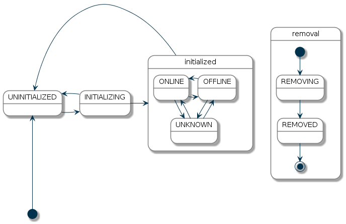

# Things

Things are the entities that can physically be added to a system and which can potentially provide many functionalities in one.
It is important to note that Things do not have to be devices, but they can also represent a web service or any other manageable source of information and functionality.
From a user perspective, they are relevant for the setup and configuration process, but not for the operation.

Things can have configuration properties, which can be optional or mandatory.
Such properties can be basic information like an IP address, an access token for a web service or a device specific configuration that alters its behavior.

## Channels

Things provide "Channels", which represent the different functions the Thing provides.
Where the Thing is the physical entity or source of information, the Channel is a concrete function from this Thing.
A physical light bulb might have a color temperature Channel and a color Channel, both providing functionality of the one light bulb Thing to the system.
For sources of information the Thing might be the local weather with information from a web service with different Channels like temperature, pressure and humidity.

Channels are linked to Items, where such links are the glue between the virtual and the physical layer.
Once such a link is established, a Thing reacts to events sent for an item that is linked to one of its Channels.
Likewise, it actively sends out events for Items linked to its Channels.

## Bridges

A special type of Thing is a "bridge".
Bridges are Things that need to be added to the system in order to gain access to other Things.
A typical example of a bridge is an IP gateway for some non-IP based home automation system or a web service configuration with authentication information which every Thing from this web service might need.

## Discovery

As many Things can be automatically discovered, there are special mechanisms available that deal with the handling of [automatically discovered Things](discovery.html).

## Thing Status

Each Thing has a status object, which helps to identify possible problems with the device or service.
The "Set by" column shows which component reports the status: the framework (openHAB core) or a binding (add-on).

| Status        | Set by    | Description                                                                                                                                                                                                                                          |
|---------------|-----------|------------------------------------------------------------------------------------------------------------------------------------------------------------------------------------------------------------------------------------------------------|
| UNINITIALIZED | Framework | The Thing has not completed initialization. This is its initial status and can also indicate an initialization failure or an unavailable binding. Commands sent to Channels are not processed.                                                       |
| INITIALIZING  | Framework | The binding is initializing the Thing. Commands sent to Channels are not processed.                                                                                                                                                                  |
| UNKNOWN       | Binding   | The handler is initialized but cannot yet determine whether the device or service is ONLINE or OFFLINE. Commands may be sent, and the Thing may already work. The binding should report ONLINE or OFFLINE as soon as it can determine which applies. |
| ONLINE        | Binding   | The device or service is assumed to be working and can process commands.                                                                                                                                                                             |
| OFFLINE       | Binding   | The device or service is assumed not to be working. Commands may still be sent so that devices that recover after receiving a command can return to ONLINE.                                                                                          |
| REMOVING      | Framework | Removal has been requested, but the binding has not confirmed it. The binding may need to unpair the device. Commands are not processed.                                                                                                             |
| REMOVED       | Binding   | The binding has completed removal handling. The Thing is usually then removed from openHAB's database.                                                                                                                                               |

### Status Transitions

The following diagram shows the allowed status transitions:

The initial status of a Thing is UNINITIALIZED.
From UNINITIALIZED the Thing goes into INITIALIZING.
If the initialization fails, the Thing goes back to UNINITIALIZED.
If the initialization succeeds, the binding sets the status of the Thing to UNKNOWN, ONLINE or OFFLINE, which all mean that the Thing handler is fully initialized.
The framework can move a Thing back to UNINITIALIZED or start removal by setting REMOVING.
Only after REMOVING can the binding report REMOVED.

## Status Details

A status is detailed further with a status detail object.
Each detail other than `NONE` maps to the status shown in the table; `NONE` can be used with any status when no further detail is available.
The following table lists the different status details for each status:

<table>
<tr valign="top"><td rowspan="8">UNINITIALIZED</td><td>NONE</td><td>No further status details available.</td></tr>
<tr valign="top">                                  <td>NOT_YET_READY</td><td>The Thing type is not fully loaded yet, so the framework cannot register its handler.</td></tr>
<tr valign="top">                                  <td>HANDLER_MISSING_ERROR</td><td>The handler cannot be initialized because the responsible binding is not available or started.</td></tr>
<tr valign="top">                                  <td>HANDLER_REGISTERING_ERROR</td><td>The handler failed in the service registration phase.</td></tr>
<tr valign="top">                                  <td>HANDLER_CONFIGURATION_PENDING</td><td>The handler is registered but cannot be initialized because of missing configuration parameters.</td></tr>
<tr valign="top">                                  <td>HANDLER_INITIALIZING_ERROR</td><td>The handler failed in the initialization phase.</td></tr>
<tr valign="top">                                  <td>BRIDGE_UNINITIALIZED</td><td>The bridge associated with this Thing is not initialized.</td></tr>
<tr valign="top">                                  <td>DISABLED</td><td>The thing was explicitly disabled.</td></tr>
<tr valign="top"><td>INITIALIZING</td>             <td>NONE</td><td>No further status details available.</td></tr>
<tr valign="top"><td>UNKNOWN</td>                  <td>NONE</td><td>No further status details available.</td></tr>
<tr valign="top"><td rowspan="2">ONLINE</td>       <td>NONE</td><td>No further status details available.</td></tr>
<tr valign="top">                                  <td>CONFIGURATION_PENDING</td><td>The Thing is waiting to transfer configuration information to a device. Some bindings need to communicate with the device to make sure the configuration is accepted.</td></tr>
<tr valign="top"><td rowspan="8">OFFLINE</td>      <td>NONE</td><td>No further status details available.</td></tr>
<tr valign="top">                                  <td>COMMUNICATION_ERROR</td><td>Error communicating with the device. This may be only a temporary error.</td></tr>
<tr valign="top">                                  <td>CONFIGURATION_ERROR</td><td>An issue with the configuration of a Thing prevents communication with the represented device or service. This issue might be solved by reconfiguring the Thing.</td></tr>
<tr valign="top">                                  <td>AUTHORIZATION_PENDING</td><td>The user must authorize access through an interaction with the device or service, such as approving access on a web page or pressing a pairing button, before the Thing can connect.</td></tr>
<tr valign="top">                                  <td>BRIDGE_OFFLINE</td><td>Assuming the Thing to be offline because the corresponding bridge is offline.</td></tr>
<tr valign="top">                                  <td>FIRMWARE_UPDATING</td><td>The Thing is currently undergoing a firmware update.</td></tr>
<tr valign="top">                                  <td>DUTY_CYCLE</td><td>The Thing is currently in DUTY_CYCLE state, which means it is blocked for further usage.</td></tr>
<tr valign="top">                                  <td>GONE</td><td>The Thing has been removed from the bridge or the network to which it belongs and is no longer available for use. The user can now remove the Thing from the system.</td></tr>
<tr valign="top"><td>REMOVING</td>                 <td>NONE</td><td>No further status details available.</td></tr>
<tr valign="top"><td>REMOVED</td>                  <td>NONE</td><td>No further status details available.</td></tr>
</table>
